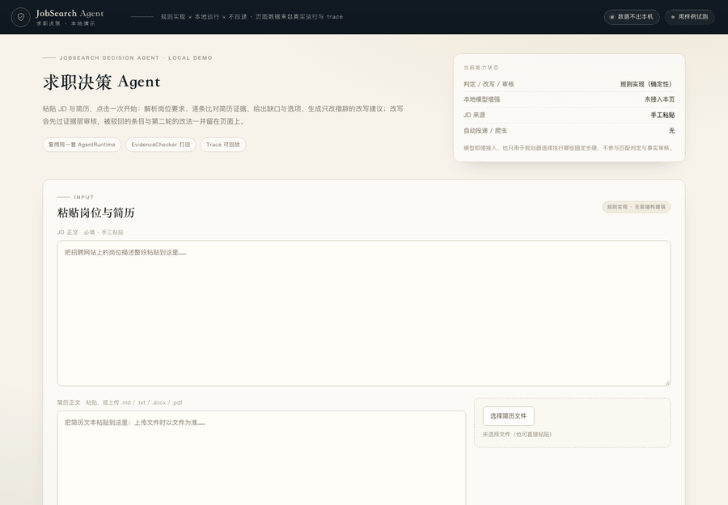
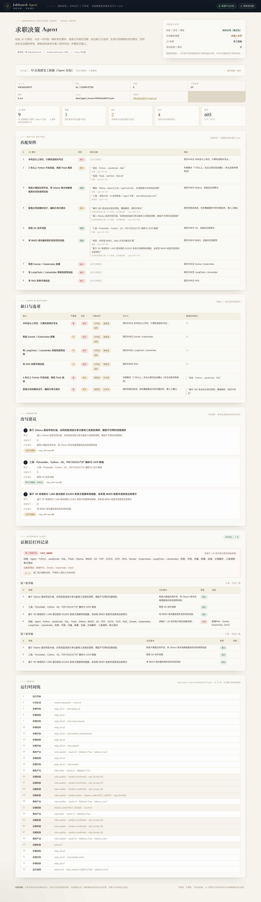
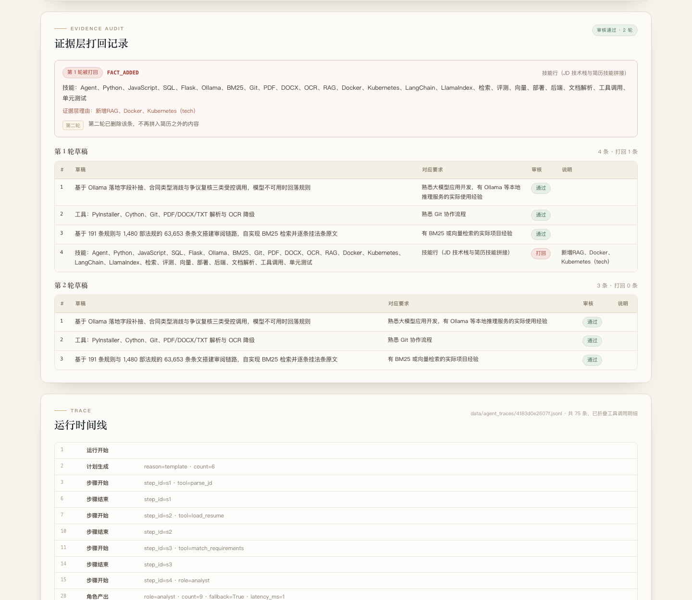

# JobSearch Decision Agent

[](https://github.com/LHQCOCO/jobsearch-agent-demo/actions/workflows/ci.yml)

一个在本机运行的求职分析 demo。粘贴 JD 和简历，点击开始，页面会列出 JD 要求的逐条判定、简历里能定位到的原句、缺口与可选动作，以及一份只改措辞的改写建议。改写提交前要过证据层审核，被驳回的条目和第二轮的改法都会留在页面上。



动图由本仓库页面真实运行后录制，总长 11.6 秒（21 帧，相同画面已合并），循环播放。画面里的 URL、run_id 和数字都来自本地这次运行，没有预置结论。



上图是在 macOS 上运行本仓库代码、用 `samples/jobs/` 里的样例跑出来的整页：9 条要求，覆盖 3 条、部分 2 条、缺少 4 条，6 个步骤、23 次工具调用。

## 它能做什么

- 接收手工粘贴的 JD 和简历。简历可以粘贴，也可以上传 MD、TXT、PDF、DOCX。
- 把 JD 拆成 must-have 与 nice-to-have，逐条判定为覆盖、部分或缺少。每条判定带简历原句和字符区间，无原文可引时如实标为「无可引用原文」。
- 给出缺口清单，按「缺少 → 部分」和严重度排序，每条附可选动作与最接近的一句原文。
- 生成最多 3 条改写建议。改写只替换措辞同义词，不新增机构、技术、数字或时间。
- 改写进入审核循环。审核器比对改写与简历实体，发现新增事实就打回，最多两轮，第二轮只保留简历既有事实。
- 可勾选写入本地投递记录（SQLite），并生成一页 Markdown 投递决策卡。
- 每次运行的 trace 落成 JSONL，页面时间线列出计划、步骤、角色产出和核查结果，工具调用明细折叠。

## 快速开始

环境：

- Python 3.11 或 3.12。
- 本仓库在 macOS 上运行并截图。CI 在 Ubuntu 上跑测试套件，覆盖 Python 3.11 和 3.12。Windows 未纳入 CI。

安装与运行：

```bash
python3 -m venv .venv
source .venv/bin/activate
pip install -r requirements.txt
python app.py
```

也可以执行 `./run.sh`，脚本会检查依赖，缺依赖时先 `pip install -r requirements.txt`，然后启动服务。

打开 <http://127.0.0.1:8899/jobsearch>。服务只绑定 `127.0.0.1`。

测试需要额外安装 `pytest`（未写入 `requirements.txt`，CI 单独安装）：

```bash
pip install pytest
python -m pytest tests -q
```

当前为 71 个用例，分布在 8 个测试文件里。CI 在 Python 3.11 和 3.12 上跑同一套用例，没有跳过或容错配置。

## 用法

在浏览器里完成一次演示：

1. 打开 <http://127.0.0.1:8899/jobsearch>。页面右侧「当前能力状态」写明判定是规则实现、模型增强未接入本页。
2. 把 JD 正文粘进第一个文本框，把简历粘进第二个文本框；也可以点「选择简历文件」上传 `.md`、`.txt`、`.pdf` 或 `.docx`。
3. 点「开始分析」。也可以点「用样例试跑」，用仓库自带的 JD 与简历各跑一次。
4. 结果页从上到下依次是运行信息（run_id、步骤数、工具调用数、耗时、trace 文件名）、计数条、匹配矩阵、缺口与选项、改写建议、证据层打回记录、运行时间线。
5. 打回记录里每条被驳回的草稿都写明 reason_code、证据层理由，以及「第二轮」的处理结果。
6. 勾选「同时写入本地投递记录」再分析，会多一个「决策卡」链接，点开是本次运行生成的 Markdown。

用 `samples/jobs/jd_ai_agent.md` 与 `samples/jobs/resume_sample.md` 跑，可复现的结果是：

- 9 条要求，覆盖 3、部分 2、缺少 4。
- 6 个步骤，23 次工具调用，本机耗时在几十毫秒量级。
- 审核 2 轮。第 1 轮第 4 条「技能：…」被 `FACT_ADDED` 打回，理由是新增了 RAG、Docker、Kubernetes；第 2 轮删除该条，其余 3 条通过。



页面上出现哪条被打回，取决于样例简历和当前规则，换一份简历结果会变。

## 工作原理

```
浏览器（templates/jobsearch.html + static/jobsearch.css）
        │  粘贴 JD / 简历，或上传文件
        ▼
Flask 应用 app.py ──► cls/scenarios/jobsearch/web.py（蓝图：页面、分析、决策卡）
        │
        ├─ JobPlanner       固定步骤模板：解析 JD → 加载简历 → 逐条匹配 → 分析师汇总 → 改写与审核 → 生成决策卡
        ├─ tools.py         J1–J7 七个工具，全部本地计算
        ├─ roles.py         analyst / tailor / auditor 三个角色，审核用内核的 ReviewLoop
        ├─ extract.py       JD 与简历的规则解析：切段、拆要求、抽实体
        ├─ documents.py     进程内暂存 JD 与简历，不落盘
        ├─ applications.py  投递记录，SQLite 新表
        └─ cls/agent/       规划、执行、证据核查、trace、模型适配（与场景无关的内核）
        │
        ▼
data/agent_traces/<run_id>.jsonl + data/exports/<run_id>-brief.md
```

### 匹配判定

`match_requirements`（`cls/scenarios/jobsearch/tools.py`）按两类情况处理：

- 要求里含技术词（`extract.TECH_TERMS`）时，看这些词在简历全文的命中情况。全中判覆盖，命中一部分判部分，全不中判缺少。
- 不含技术词时，把要求和简历都切成中文双字与拉丁词，按重合率判定：≥ 0.6 覆盖，≥ 0.2 部分，其余缺少。

另外两条约束：

- JD 写了年限（`3 年以上`、`1-3 年`），而简历里没有全职年限表述时，判定降为部分，理由写明「无法从简历自动确认」。
- 判为覆盖或部分，但没有一句能通过 `EvidenceChecker` 定位的原文时，降为部分，理由写明「未能定位到可引用的原文」。

### 证据层审核

`tailor` 产出改写后，`auditor` 对每条做三件事：

1. 检查有没有 `text` 和 `based_on_spans`。
2. 逐条校验引用的句子序号是否越界、原句能否在简历原文中定位（`EvidenceChecker.check_span`）。
3. 把改写文本与简历实体比对，找出新增的机构、技术、数字、时间（`detect_new_facts`）。有新增就判 `FACT_ADDED`。

`ReviewLoop` 的打回上限是 2 轮。被打回的条目在页面「证据层打回记录」里保留草稿、理由和第二轮的改法。

## 项目结构

```
app.py                     Flask 入口：创建应用、注册蓝图、根路径跳转
cls/
  agent/                   Agent 内核：规划器、执行器、注册表、证据核查、角色与审核循环、trace、模型适配
  scenarios/
    base.py                场景契约
    jobsearch/
      manifest.py          场景装配：工具、角色、规划器、渲染
      planner.py           固定步骤模板与可选模型规划
      tools.py             J1–J7 工具
      roles.py             analyst / tailor / auditor
      extract.py           JD 与简历解析、实体抽取
      documents.py         JD 与简历的进程内暂存
      applications.py      投递记录（SQLite）
      prompts.py           角色与规划器提示词
      web.py               演示页、分析接口、决策卡路由
  config.py                路径、Agent 预算、本机模型地址
  parsing.py               简历文件解析（MD / TXT / PDF / DOCX）
  llm.py                   本机 Ollama 探测（只访问 127.0.0.1）
templates/ static/         页面与样式，无前端构建链
samples/jobs/              演示用 JD 与简历
docs/                      README 使用的演示动图与三张截图
tests/                     71 个用例，8 个测试文件
.github/workflows/ci.yml   CI 配置
```

## 已知限制

- 模型增强没有接入。`JobPlanner` 保留了调用本机模型的接口，页面不传 adapter，实际走固定步骤模板。页面上标为「未接入本页」，没有伪装成已完成。
- 匹配是关键词加年限的启发式。技术词按整词命中，中文要求按双字重合率，两者都不理解语义。同义表达、隐含经验、项目规模这类判断会漏。
- 改写只做同义词替换。`roles._rephrase` 只换「负责 / 承担」「使用 / 基于」这类词，不会重写句子结构，也不会补简历里没有的内容。
- 缺口选项是固定模板。每条缺口给「补作品 / 换表述 / 放弃」这类动作，不做可行性判断。
- 不爬取、不投递。JD 由用户手工粘贴，没有招聘网站抓取，也没有任何自动投递或账号登录逻辑。
- 单机单用户。没有账号体系，数据存在本机 `data/`，不支持多人并发。
- 审核规则只看实体。新增事实按机构、技术、数字、时间四类判定，措辞层面的夸大不会被拦下。
- 简历解析不含 OCR。扫描件 PDF 会提示改用可复制文字的版本。
- 样例简历是虚构内容，姓名、公司、邮箱均为占位，不对应真实个人。
- 依赖版本未锁定。`requirements.txt` 使用 `>=` 下限，不同时间安装可能得到不同版本。
- Windows 未纳入 CI，本仓库只在 macOS 上运行验证过。

## 数字与出处

| 数字 | 值 | 出处与核对方式 | 口径 |
|---|---|---|---|
| 场景工具 | 7 个 | `python -c "from cls.scenarios import JOBSEARCH_SCENARIO as s; print(len(s.tools))"` | 求职场景注册的工具数 |
| 角色 | 3 个 | `python -c "from cls.scenarios import JOBSEARCH_SCENARIO as s; print(sorted(s.roles))"` | analyst / tailor / auditor |
| 自动化用例 | 71 个 | `python -m pytest tests --collect-only -q` | 当前 `tests/` 的收集结果 |
| 测试文件 | 8 个 | `ls tests/test_*.py` | 不含 `conftest.py` |
| 样例 JD 要求 | 9 条 | 打开 `http://127.0.0.1:8899/jobsearch?autorun=1`，「JD 要求」计数条 | must-have 与 nice-to-have 之和 |
| 样例判定分布 | 覆盖 3 / 部分 2 / 缺少 4 | 同一页面的计数条 | 与当前规则版本绑定，规则调整后会变 |
| 样例运行步骤 | 6 个 | `?autorun=1` 的 meta 行，或 `tail -1 data/agent_traces/<run_id>.jsonl` 的 `steps` | 不勾选「写入投递记录」时的步骤数 |
| 样例工具调用 | 23 次 | 同上，`tool_calls` 字段 | 单次运行的累计调用 |
| 样例 trace 事件 | 75 条 | 页面「运行时间线」标题右侧的计数 | 含折叠的工具调用明细 |
| 审核轮数上限 | 2 轮 | `cls/scenarios/jobsearch/roles.py` 中 `ReviewLoop(max_rejections=2)` | 超出后不再改写，直接保留结论 |
| 单轮改写上限 | 3 条 | `cls/scenarios/jobsearch/roles.py` 中 `if len(bullets) >= 3` | 不含首轮补的技能行 |
| 简历上传上限 | 25 MB | `cls/parsing.py` 中 `MAX_BYTES` | 单份文件 |
| JD 字数上限 | 40,000 字 | `cls/scenarios/jobsearch/web.py` 中 `MAX_JD_CHARS` | 超出直接报错，不截断 |
| 简历字数上限 | 80,000 字 | `cls/scenarios/jobsearch/web.py` 中 `MAX_RESUME_CHARS` | 同上 |
| 演示动图 | 21 帧 / 共 11,600 ms | `python -c "from PIL import Image, ImageSequence; im=Image.open('docs/demo.gif'); print(len(list(ImageSequence.Iterator(im))), sum(f.info['duration'] for f in ImageSequence.Iterator(im)))"` | 900×625，页面录制后合成，相同画面已合并 |

## 许可

本仓库源码仅用于作品展示，保留所有权利。没有使用 MIT、Apache-2.0 或其他开源许可证，也不授权复制、修改、分发或商业使用。

第三方组件的来源与许可见 [THIRD_PARTY_NOTICES.md](THIRD_PARTY_NOTICES.md)。
